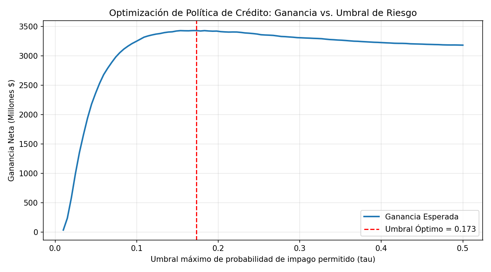
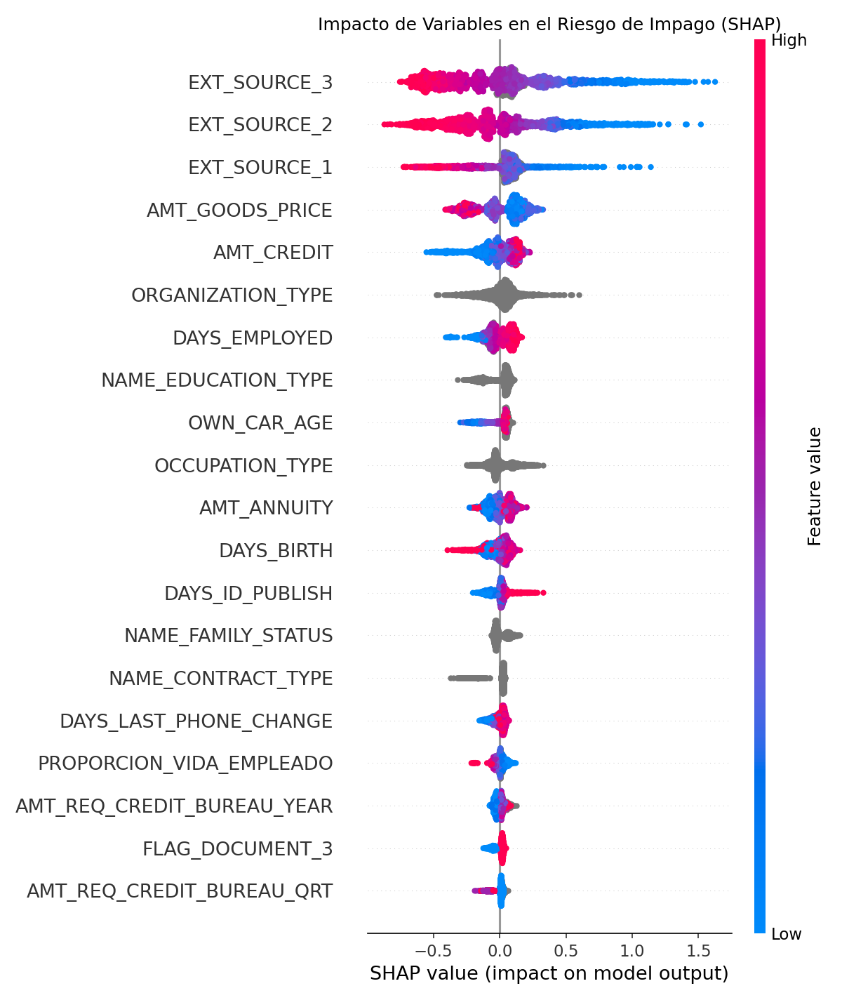

# Optimización de Aprobación de Crédito con LightGBM y Valor Esperado

Modelo de evaluación de riesgo crediticio sobre el dataset *Home Credit Default Risk* (~307k solicitudes), enfocado en **maximizar la utilidad financiera neta** mediante la optimización del umbral de decisión $\tau^*$, en lugar de utilizar un corte arbitrario de `0.50`.

## Resumen de Resultados
* **Comparativa de discriminación:** Regresión Logística (baseline) vs. LightGBM con manejo nativo de valores faltantes, variables categóricas y ratios financieros (`AMT_CREDIT / AMT_INCOME_TOTAL`, `AMT_ANNUITY / AMT_INCOME_TOTAL`, `DAYS_EMPLOYED / DAYS_BIRTH` y `AMT_CREDIT / AMT_GOODS_PRICE`).
* **Decisión financiera ($\tau^*$):** Se modeló una función de ganancia esperada considerando ingresos por créditos pagados y pérdidas por impago para encontrar el umbral óptimo de aprobación en validación.
* **Equidad y explicabilidad:** Se excluyó `CODE_GENDER` por criterio de cumplimiento/equidad y se auditaron los factores determinantes del riesgo mediante valores **SHAP**.

## Visualizaciones

## Estructura
* `riesgo_crediticio.ipynb`: Flujo completo de preparación de datos, baseline, entrenamiento de LightGBM, optimización de umbral y análisis SHAP.
